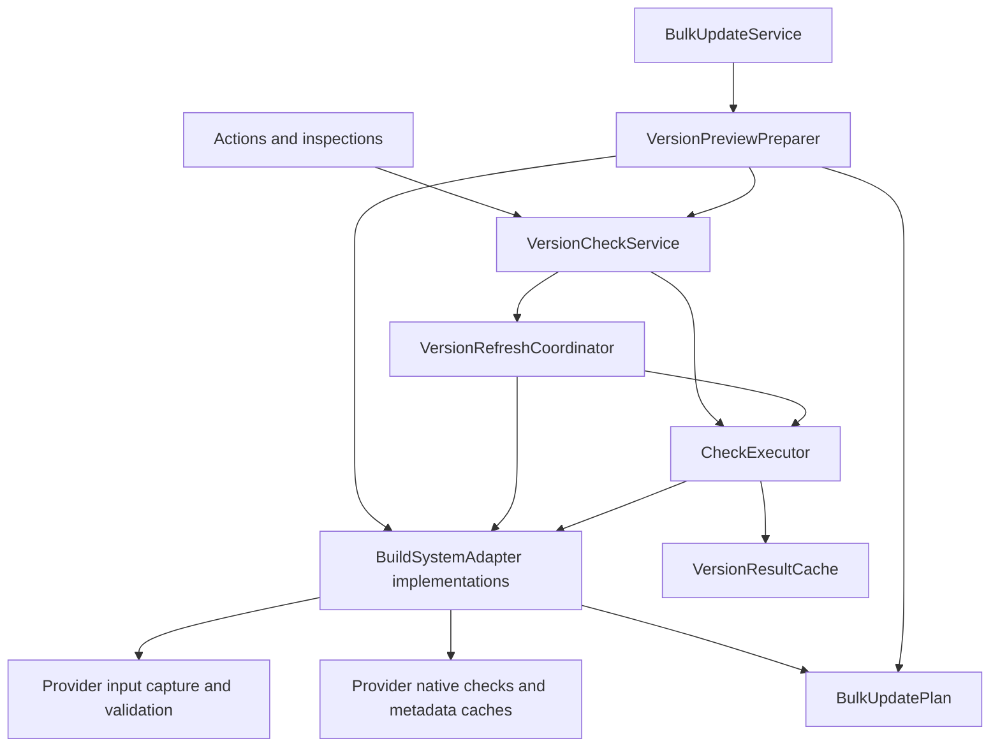

# Architecture

Version Checker shares the check and edit workflow across Maven, npm, pnpm, Yarn, Bun, and Gradle adapters.
Each adapter owns repository resolution, declaration parsing, and build-specific IntelliJ APIs.

## Responsibilities

| Component | Responsibility |
| --- | --- |
| `core/BuildSystemAdapter` | Define discovery, snapshots, native checks, and update preparation. Provider plugin descriptors register optional IDE integrations. |
| `VersionCheckService` | Provide project entry points, lifecycle control, editor selection, and inspection input caching. |
| `VersionRefreshCoordinator` | Discover inputs and manage refresh requests, retries, and progress. `VersionRefreshRequest` defines manual and retry policies. |
| `CheckExecutor` | Queue checks, handle cancellation, publish results, and access the result cache. |
| `core/VersionResultCache` | Track result identities, revisions, expiry, and inspection leases. |
| `BulkUpdateService` | Manage previews, dialogs, source navigation, and accepted updates. |
| `VersionPreviewState` | Track dialog state and generation. Reject old selections after refresh, replacement, cancellation, or disposal. |
| `PreviewRequestController` | Cancel asynchronous requests and deliver only the current result on the EDT. |
| `VersionPreviewPreparer` | Collect adapter reports and plans. Bind combined plans to observed results and settings. |
| `core/DeclarationCoverageAccumulator` | Combine coverage by provider and physical declaration across check contexts. |
| `core/FileDigestCache` | Reuse hashes for saved files and unsaved documents when their stamps match. |
| `gradle/GradleBuildInputs` | Track build ownership and inputs. Capture external inputs and validate edit inputs. |
| `DependencyReviewRows` / `DependencyReviewOutcome` | Convert cached observations to display data. Keep typed outcomes separate from UI labels. |
| `BulkUpdatePlan` | Combine plans, select edits, validate inputs, and apply one command that the user can undo. |
| `followup/` | Reload builds and synchronize npm lockfiles after explicit user actions. |



## Preview and apply

1. The UI selects a scope and saves the relevant build inputs.
2. The preparer asks each adapter to discover immutable snapshots.
3. Each adapter uses `withScan` to control native resource lifetime. The preparer can reuse current successful reports.
4. Each report must remain the exact cached result that the preparer observed.
5. The adapters prepare edits and capture their input validation requirements.
6. The combined plan keeps authorization checks for the results and complete shared/workspace dependency policy. Selecting fewer edits keeps these checks.
7. Before application, the plan checks authorization and captures external inputs without write access.
8. Inside the write command, the plan checks authorization and inputs again. Final validation and declaration writes are atomic.

`SharedProjectPolicy` parses strict schema-versioned project rules and composes them with workspace restrictions.
`VersionPresentationPolicy` applies one predicate to hints, status, review rows and previews without modifying raw reports.
Providers use effective deprecations and include shared policy input in their fingerprints.
Each provider captures fresh physical policy input before write access, including absent, created or deleted files.
The final callback reads IDE state only.
Shared-file VFS/document changes retire observations and inspection inputs.
Parsed content and snapshots are cached by saved/document stamps and local text.
Expiry boundaries retire snapshots without reparsing, keeping repeated status and atomic guard reads cheap.

`VersionPreviewState` tracks ready, checking, failed, applying, accepted, and closed reviews.
The dialog checks each selection against the current generation, mode, and scope.
Refresh and replacement invalidate older selections. Cancellation or disposal closes authorization.
An accepted modal review keeps its selection for application after the dialog closes.
A queued apply callback can finish only its own generation.
It cannot clear a newer check or failure.
`PreviewRequestController` rejects old asynchronous results separately.

Result leases and provider input validation authorize edits.
Dialog state cannot extend result expiry.
Inspection hints and retained warnings cannot authorize a preview or edit.
Reading the dependency tool window must not start native checks.

## Refresh policy

Manual refresh first invalidates metadata and results.
It then saves the requested inputs, discovers snapshots, and runs checks.
Current-file requests have interactive queue priority.
Whole-project manual refreshes run in sequence.

Retries also have interactive priority.
They keep provider and source targets through saving, discovery, invalidation, and failure reporting.
Missing sources produce a failure report.

Scheduled refreshes skip active work, offline providers, and unsaved resolution inputs.
They do not save editor changes.
They invalidate metadata only for providers with eligible snapshots.
They invalidate each source immediately before its check.

## Shared code and provider rules

Maven and npm keep separate metadata caches.
Maven batches requests and keeps metadata in memory only.
npm, pnpm, Yarn and Bun share package workers and retained version indexes. Manager identity and native configuration isolate their metadata/runtime sessions; pnpm YAML changes also invalidate cached workspace ownership.
`MetadataCacheContractTest` checks their common lifecycle rules.

File hashing is shared because saved bytes and unsaved editor text use the same identity rules.
Providers own input inventories and combined-hash invalidation.
Providers also own inspection normalization.
Gradle can retain warnings across supported version-value changes.
Those changes must still invalidate edit authorization.

Keep build-specific IntelliJ APIs in their provider packages.
This keeps optional plugin dependencies separate.
Add shared code to `core` only when its behavior is the same for all providers.
Format UI labels for display and export. Use typed outcomes for filtering and timing.

## Coverage

Coverage counts recognized declarations, including declarations skipped before native resolution.
A shared declaration can appear in several resolution contexts.
`sourceId` maps these observations to one physical declaration within a provider.

If contexts disagree, keep the outcome with the highest priority:
failed, manual review, checked, ignored, then skipped.
Missing outcomes stay pending.
If any report has unknown coverage, the combined summary stays unknown.
Dialogs and native build tools do not define these rules.

## Native follow-up observations

`UpdateSessionStore` retains bounded immutable per-attempt steps with explicit statuses. Native reloads, npm commands and version observations have separate kinds. A session/step token attributes asynchronous updates; evicted tokens cannot modify newer attempts. The modeless summary polls memory snapshots and stops its timer when disposed. Passive viewing never starts native work.

`NativeFileChangeCapture` takes cancellable, bounded physical UTF-8 snapshots of supported npm outputs before explicit command approval and after inspection. The before snapshot is compared to the command-preview hash baseline. File creation/deletion is represented separately from empty text. File limits, byte/text budgets, read failures, symlinks, invalid text and unstable reads omit whole files with a reason. `UpdateSessionStore` evicts native text independently from typed outcomes and declaration snapshots.

Native snapshots are observational: they cannot prove exclusive writer ownership, and concurrent external changes may be included. Unsaved editor overlap and unconfirmed process termination add explicit limitations. Inspection failure does not change a completed process into verified dependency evidence. Native diff requests are read-only and separate from declaration undo; snapshots contain no live documents, PSI or process handles.

## Maven update verification

Maven prepared edits retain immutable consumer identities separately from physical XML ownership. A shared property or managed version can change several imported POM contexts; local overrides retain only their own child context. Quick fixes and bulk plans use the same ownership analysis. Selecting bulk edits preserves only those edits' consumers. Immediately before the authorized write, historical capture binds expected dependency versions to the current native-resolution generation and stores them with that update's captured file diff.

`MavenUpdateVerificationService` accepts model evidence only after completion of its explicit full-import request with identical saved input captures before and after import. Verification compares those inputs, the captured after-text and the current IDE documents/settings/profiles again. Existing models and late unrelated resolution events cannot authorize confirmation. Bounded diff/session storage and unavailable or omitted captures keep their existing fail-closed behavior. Plugin/parent versions and runtime compatibility are not inferred from imported dependencies.

The service subscribes to `MavenImportListener.TOPIC`, available in both supported IDE branches. Import and resolution events invalidate captured evidence. Disposing the service disconnects its listener.

## IntelliJ API dependencies

Kotlin uses JVM default methods without compatibility bridges. This lets SDK interfaces supply their defaults without generated calls to deprecated or experimental methods.
Settings sections use UI DSL `collapsibleGroup`. Project-policy reads use `ReadAction.computeBlocking` to preserve their synchronous lock behavior.
Document saves run on EDT. The `Dispatchers.EDT` dispatcher acquires the write-intent lock; saving needs no additional `WriteIntentReadAction` wrapper.

Maven metadata and Versions goals run in separate Java processes through Maven's Classworlds launcher.
`MavenGoalProcess` selects IDEA's Maven distribution, including resolved wrapper distributions, and its import JDK and VM options.
It passes the selected POM, profiles, user settings and local repository as arguments. Maven reads credentials, mirrors, proxies and transports itself.
The runner limits concurrent goal processes to two. Each goal has a five-minute timeout and retains at most 1,048,576 diagnostic characters across both streams.
Cancellation terminates the goal and its child processes before request-file cleanup. Goal execution does not save documents or open Run consoles.
Category and batch progress remain available; embedded Maven artifact progress is no longer forwarded.

Maven CLI always reads an existing `.mvn/maven.config`. If IDEA is configured to ignore that file, goal checks report the unsupported configuration.
They do not silently activate settings which IDEA ignores. Native model capture and effective-version verification retain their existing IDE integration.
The metadata protocol proves helper completion. If a Versions goal produces no report, the runner also requires Maven's success message.
Quiet output, log redirection or informational CLI options can prevent that confirmation. Such checks report an unavailable result instead of claiming no updates.

Only the reload integration still requires experimental SDK APIs.
`MavenSyncSpec.full` and suspending `MavenAsyncProjectsManager.updateAllMavenProjects` identify and await the full reload used for verification.
A scheduled request or unrelated completion event cannot establish this evidence. Verify the packaged plugin against both supported IDE branches when these calls change.

## Verification

| Tests | Checks |
| --- | --- |
| `DeclarationCoverageAccumulatorTest` | Conflicting context outcomes, provider isolation, pending declarations, and unknown totals. |
| `FileDigestCacheTest` | Unsaved edits, saves, and VFS changes with cached documents. |
| `BuildCoordinatorTest` | Refresh, preview preparation, scheduling, cache reuse, ignored versions, shared declarations, and rejection of old results. |
| Provider capture tests | External changes and read-lock boundaries. |
| `VersionPreviewStateTest` | State transitions, authorization, and late apply completion. |
| `BulkUpdateDialogTest` | Held-plan cancellation and recovery from queued callback failures. |
| `BulkPreviewLifetimeTest` and preview recovery tests | Dialog cancellation and disposal. |
| `DynamicPluginLifecycleTest` | Plugin unload and reload. |

Run the default suite and build checks:

```bash
./gradlew test buildPlugin verifyPluginProjectConfiguration
```

Select native repository integration tests explicitly.
See the [verification guide](user-guide.md#development-and-verification).
Use the [writing rules](writing.md) for comments, documentation, and user messages.
