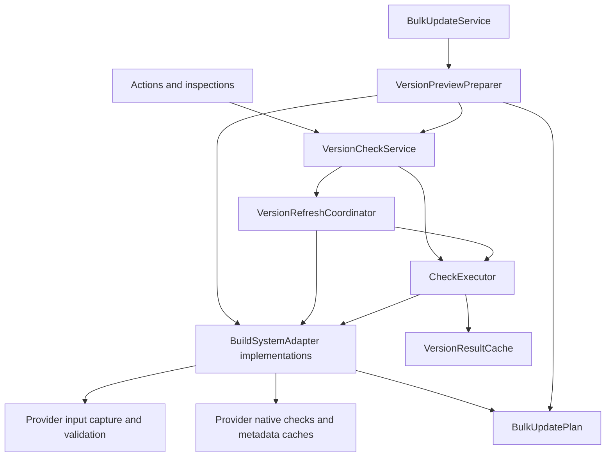

# Architecture

Version Checker uses a shared checking and editing workflow with build-system adapters for Maven, npm, and Gradle. Keep repository resolution, declaration parsing, and build-specific IntelliJ APIs in the adapter packages.

## Responsibilities

| Component                                          | Owns                                                                                                                                                            |
|----------------------------------------------------|-----------------------------------------------------------------------------------------------------------------------------------------------------------------|
| `core/BuildSystemAdapter`                          | Provider contract for discovery, snapshots, native checks, and update preparation. Optional IDE integrations are registered in the provider plugin descriptors. |
| `VersionCheckService`                              | Project service entry points, lifecycle, editor selection, and inspection input caching.                                                                        |
| `VersionRefreshCoordinator`                        | Manual and scheduled refresh discovery, retries, progress, and refresh activity. `VersionRefreshRequest` keeps their distinct policies explicit.                |
| `CheckExecutor`                                    | Check queues, cancellation, result publication, and access to the result cache.                                                                                 |
| `core/VersionResultCache`                          | Result identities, revisions, expiry, and inspection leases.                                                                                                    |
| `BulkUpdateService`                                | Preview interactions, dialog lifecycle, navigation, and orchestration of accepted updates.                                                                      |
| `VersionPreviewPreparer`                           | Collection of adapter reports and plans, cache reuse, and binding the combined plan to observed results and settings. It does not construct dialogs.            |
| `core/DeclarationCoverageAccumulator`              | Coverage across scan contexts, grouped by provider and physical declaration.                                                                                    |
| `core/FileDigestCache`                             | Stamp-based reuse of saved VFS and unsaved document hashes. Providers own inventory and aggregate-hash invalidation.                                            |
| `gradle/GradleBuildInputs`                         | Linked-build ownership, input discovery, external capture, fingerprints, coverage limitations, and edit-input validation.                                       |
| `DependencyReviewRows` / `DependencyReviewOutcome` | Passive presentation of observations, with typed outcomes independent of UI labels.                                                                             |
| `BulkUpdatePlan`                                   | Plan composition, selection, input validation, and one undoable write command.                                                                                  |
| `followup/`                                        | Explicit build reloads and npm lockfile synchronization after edits.                                                                                            |



## Preview and apply

1. The UI selects a scope and saves the relevant build inputs.
2. The preparer asks each adapter to discover immutable snapshots. Native resources are scoped through `withScan`; current successful reports can be reused.
3. Each checked report must still be the exact cached result observed by the preparer. Adapters prepare edits from those reports and capture their build-specific validation requirements.
4. The combined plan keeps a guard on the results and ignored-version policy. Selecting fewer edits preserves that authorization.
5. Applying validates authorization before input capture and again inside the write command. Providers capture external inputs before acquiring write access. The final validation and declaration writes happen atomically.

Inspection hints and retained warnings are presentation data. They must not authorize a fresh preview or an edit. Reading the dependency tool window also must not start native checks.

## Refresh policy

Manual refresh invalidates metadata and results immediately, saves the requested inputs, then discovers and checks them. A current-file request has interactive queue priority. Whole-project manual refreshes serialize with scheduled refreshes.

Retries also have interactive priority. They retain their provider/source targets through saving, discovery, invalidation, and failure reporting. Missing sources must be reported rather than silently discarded.

Scheduled refreshes skip active work, offline providers, and unsaved resolution inputs. They do not save editor changes. They invalidate metadata only for providers with eligible snapshots and invalidate each source immediately before its check.

## Shared infrastructure and provider policy

Maven and npm metadata caches deliberately remain separate: Maven batches requests and supports persistence; npm shares individual package workers and accounts for retained version indexes. Their common lifecycle expectations are tested through `MetadataCacheContractTest` rather than hidden behind a generic cache with provider switches.

File hashing is shared because saved bytes and unsaved editor text follow the same identity rules. Inspection normalization remains provider-owned: Gradle can ignore supported version-value changes when retaining warnings, while those changes must still invalidate edit authorization. Shared infrastructure must not erase that distinction.

Keep provider-specific IntelliJ APIs in their provider packages so optional plugin dependencies remain isolated. Add shared mechanisms to `core` only when they have the same semantics across providers. UI labels are formatted at presentation/export boundaries; filtering and timing use typed outcomes.

## Coverage

Coverage counts recognized declarations, including declarations skipped before native resolution. A shared declaration can appear in several resolution contexts; `sourceId` maps those observations back to one physical declaration within a provider.

When contexts disagree, the accumulator keeps the outcome requiring the most attention: failed, manual review, checked, ignored, then skipped. Missing outcomes remain pending. If any report has unknown coverage, the combined summary stays unknown. These rules are independent of dialogs and native build tools.

## Verification

`DeclarationCoverageAccumulatorTest` checks conflicting context outcomes in both orders, provider isolation, pending declarations, and unknown totals. `FileDigestCacheTest` checks unsaved edits, saves, and VFS changes with cached documents. `BuildCoordinatorTest` exercises refresh and preview preparation through the service, including scheduling, cache reuse, ignored versions, shared declarations, and stale-result guards. Provider capture tests verify external changes and read-lock boundaries. Dialog cancellation and disposal are covered by `BulkPreviewLifetimeTest` and the preview recovery tests; `DynamicPluginLifecycleTest` checks plugin unload and reload.

Run the default suite and build checks with:

```bash
./gradlew test buildPlugin verifyPluginProjectConfiguration
```

Native repository integration tests remain opt-in; see the [verification guide](user-guide.md#development-and-verification).
